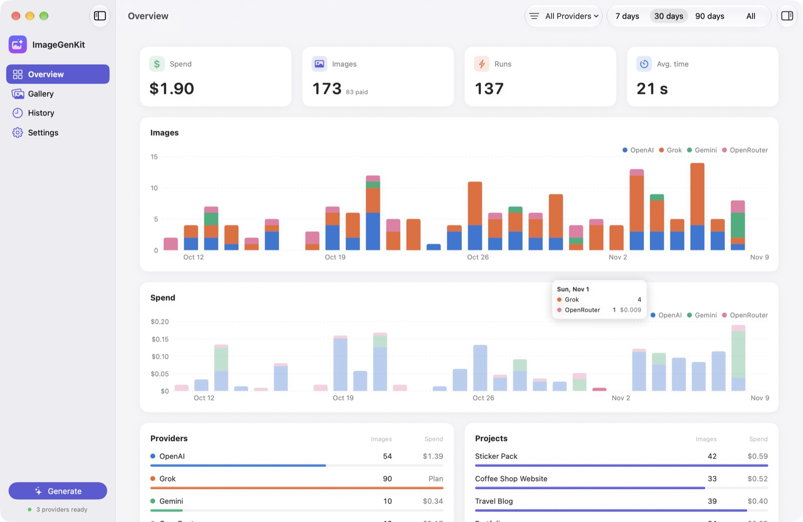
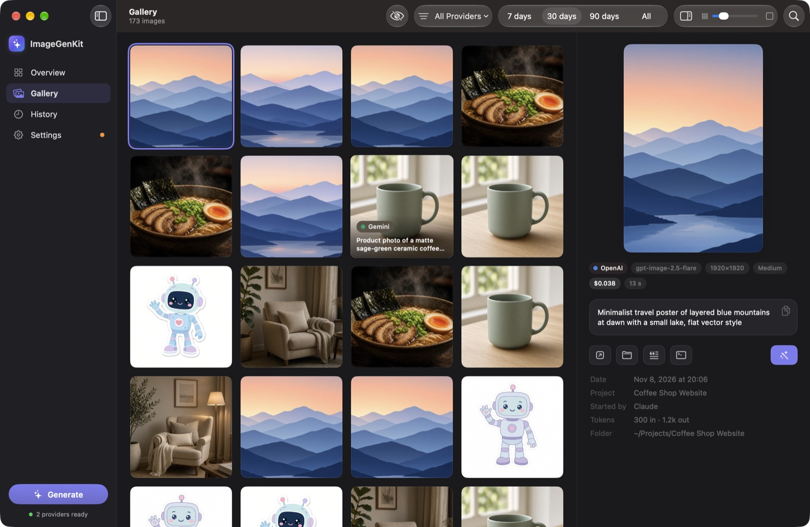
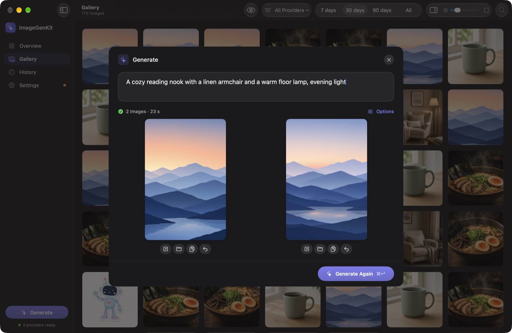
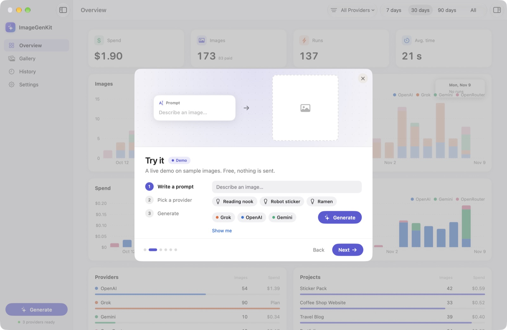
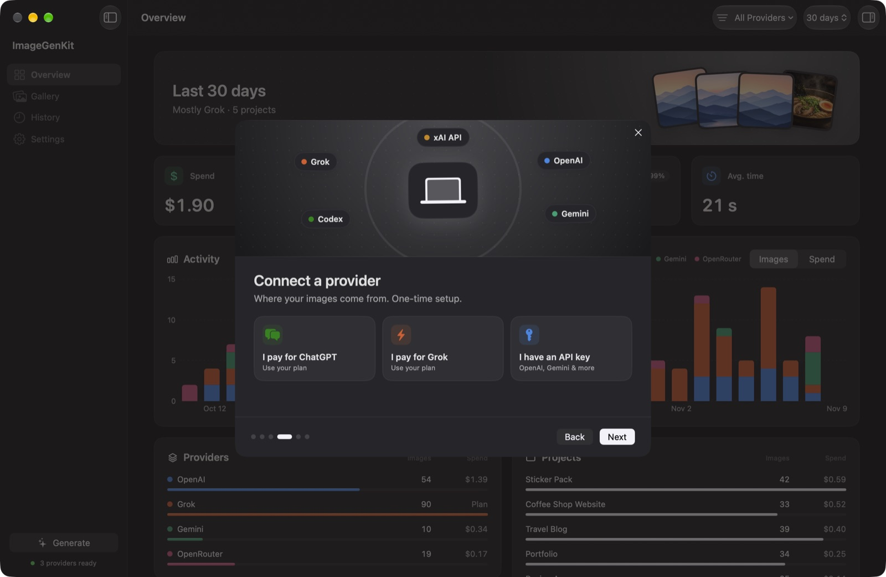
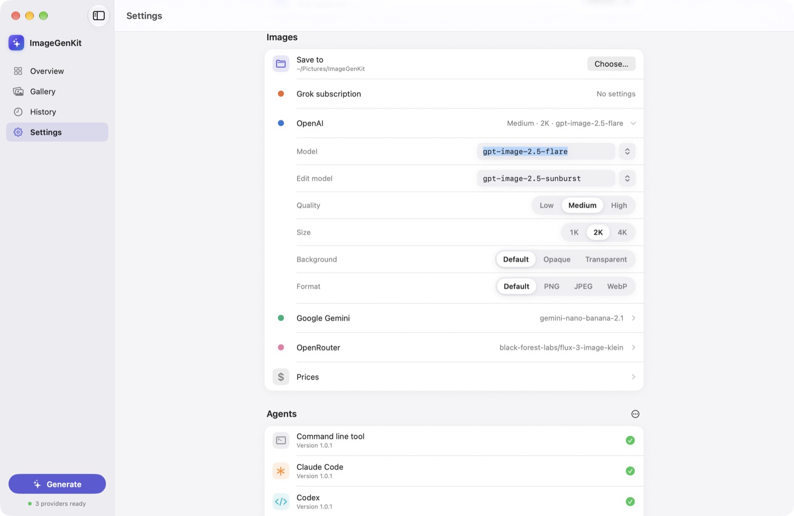
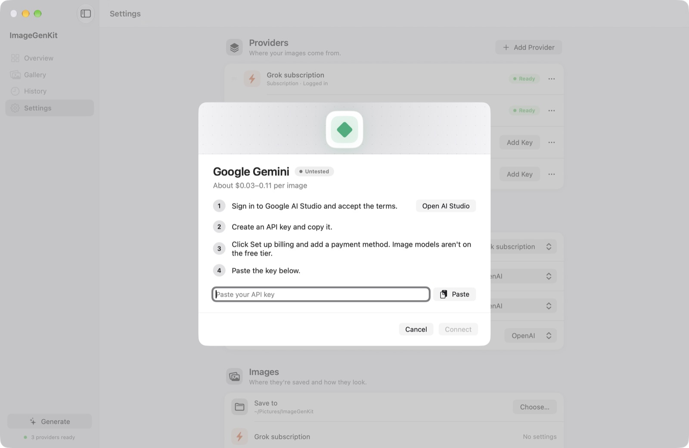
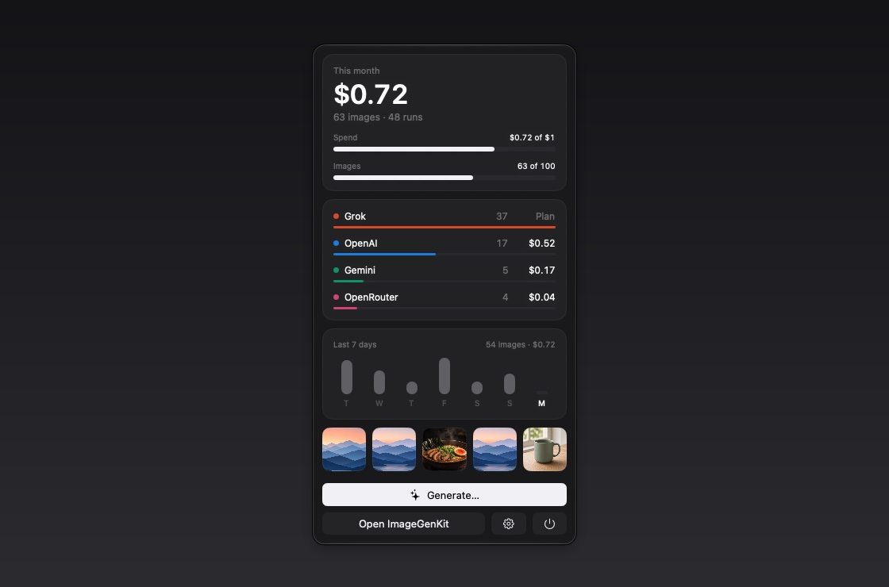
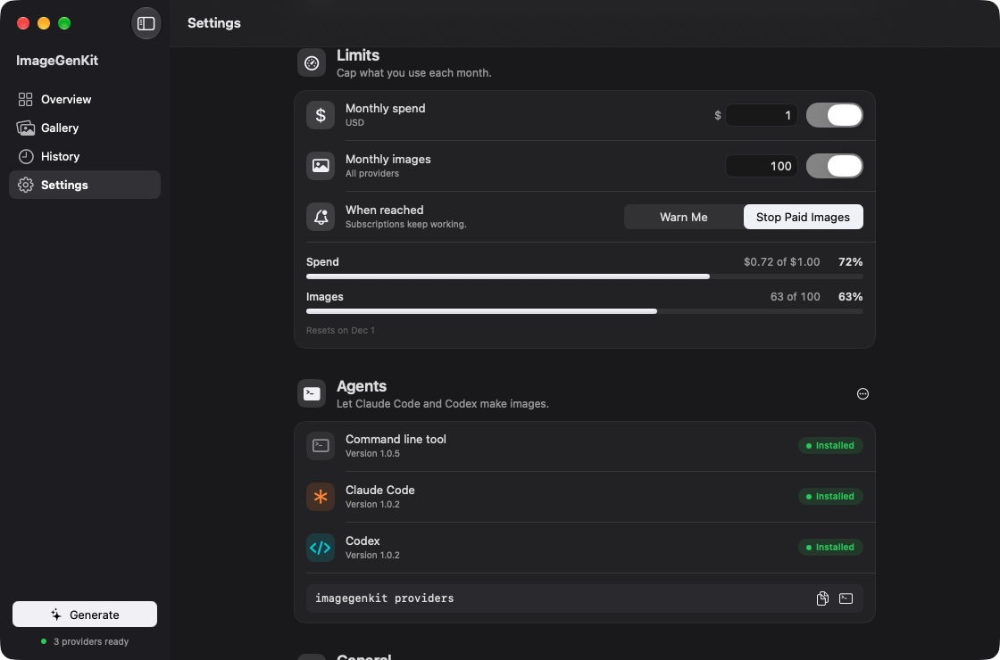
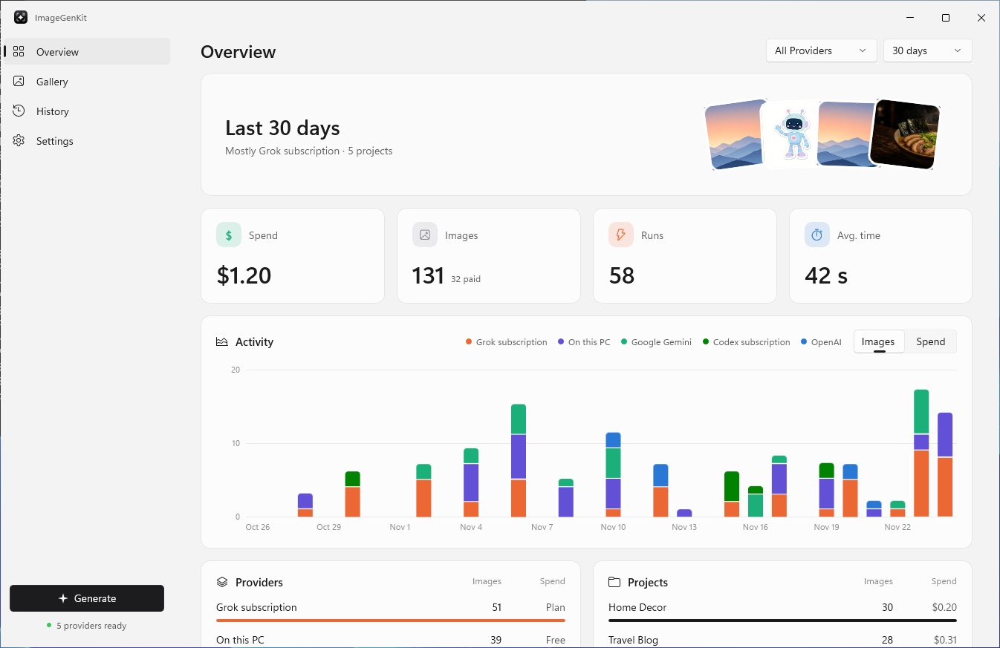

<p align="center">
  
</p>

<h1 align="center">ImageGenKit</h1>

<p align="center">
  AI images on your Mac with the accounts you already have: ChatGPT, Grok, OpenAI, Gemini and more, or free open models that run on your Mac.<br>
  Make images by hand, see everything you made and what it cost, and let Claude Code or Codex make images for you.
</p>

<p align="center">
  <a href="https://github.com/davidkrammer/imagegenkit/releases/latest"><b>Download for Mac</b></a> ·
  <a href="#windows">Windows</a> ·
  <a href="#install-with-your-ai-agent">Install with your AI agent</a> ·
  <a href="#command-line">Command line</a> ·
  <a href="#support">Donate</a>
</p>



## What it does

- **Easy setup.** A short welcome tour finds what's already on your Mac (Grok or Codex logged in, saved API keys, Claude Code, Codex) and connects it in one click. If nothing is there, it asks simple questions ("I pay for ChatGPT", "I pay for Grok", "I have an API key") and walks you through the rest.
- **Use your subscriptions.** Make images with your ChatGPT plan (through Codex) or your Grok plan (through Grok Build), with no API key and no per-image bill.
- **Or run models on your Mac.** "On this Mac" downloads open models like FLUX.2 klein and Z-Image Turbo with one click and runs them right on your Mac: free, private, and they work offline. Search Hugging Face for more, or paste a link. Needs Apple silicon.
- **Or bring an API key.** OpenAI, Google Gemini, xAI, OpenRouter, Recraft, Together AI, fal.ai, or any OpenAI-compatible API, each with a step-by-step guide to get a key. Keys stay in your macOS Keychain.
- **Generate by hand.** Write a prompt, add reference images, pick a provider, and set only the options that provider supports.
- **Gallery and history.** Everything you or your agents made, with prompts, sizes, costs and files. Use any image as a reference for the next one.
- **Usage and costs** per day, month, provider and project, plus a **menu bar** item with this month's spend, per-provider bars and recent images.
- **Monthly limits.** Set a spend or image limit. You get a notice at 80 % and 100 %, and if you choose "Stop paid images", paid providers pause until next month while your subscriptions keep working, for you and for your agents.
- **Settings per provider.** Model, quality, size, background and format for each provider, plus "Use for": which provider makes drafts, finals, edits and transparent PNGs. If one isn't set up, the next one in your list is used.
- **For AI agents.** Installs the `imagegenkit` command and a skill for Claude Code and Codex, so your agent makes images that follow your settings.
- **Stays up to date.** The app updates itself from GitHub and keeps the `imagegenkit` command and agent skills current. Without the app, the command checks for a new release once a day and updates itself (`imagegenkit update` does it now; set `"auto_update": false` in the config to turn it off). The provider list updates without a new version.

| Gallery | Generate |
|---|---|
|  |  |

| Welcome tour | Connect a provider |
|---|---|
|  |  |

| Settings | Key guide |
|---|---|
|  |  |

| Menu bar | Monthly limits |
|---|---|
|  |  |

## Windows

### Install

Download **ImageGenKit-Setup-x.y.z.exe** from the [latest release](https://github.com/davidkrammer/imagegenkit/releases/latest)
and run it. It installs for your user only (no admin rights) into `%LOCALAPPDATA%\Programs\ImageGenKit`, brings
everything it needs (its own Python included), and adds ImageGenKit to the Start menu. Windows 10 (version 2004 or later) or Windows 11, 64-bit.

The installer isn't code-signed yet, so Windows SmartScreen may say "Windows protected your PC": click **More info**,
then **Run anyway**. Updates come from GitHub releases; the app checks each download against GitHub's SHA-256 checksum
before installing it.



### The app

A native Windows app (WinUI 3) with the same parts as the Mac app: Overview with spend and activity, Gallery, History,
Generate (with reference images), and Settings for providers, task routing, monthly limits, models on this PC and AI
agents. It follows the Windows light or dark mode, and a short welcome tour with a hands-on demo shows the way at first
launch. In Settings › AI agents it installs the `imagegenkit` command (into `%USERPROFILE%\.local\bin`, on your PATH)
and the skill for Claude Code and Codex.

### Command line only

Without the app, in PowerShell:

```powershell
irm https://raw.githubusercontent.com/davidkrammer/imagegenkit/main/install.ps1 | iex
```

It needs Python 3.9+ (`winget install Python.Python.3.13` if you don't have it). It installs the command into
`%USERPROFILE%\.local\bin` (and on your PATH), the skill for Claude Code and Codex, and a lightweight browser version of
the app (`imagegenkit app`): a local web app in an Edge or Chrome app window, on 127.0.0.1 only with a per-launch token.
From a checkout: `powershell -ExecutionPolicy Bypass -File install.ps1`.

### What's different on Windows

| | macOS | Windows |
|---|---|---|
| API keys | Keychain | Windows Credential Manager (`imagegenkit-<provider>` generic credentials) |
| Images (convert, resize, thumbnails) | `sips` | Pillow if installed, else Windows Imaging Component (built in) |
| On this Mac / PC | Metal build of stable-diffusion.cpp, Apple silicon | Vulkan build (any recent NVIDIA, AMD or Intel GPU) or CPU build: `imagegenkit config set local_backend cpu` |
| Grok subscription | `curl -fsSL https://x.ai/cli/install.sh \| bash` | `irm https://x.ai/cli/install.ps1 \| iex` (the app can open it in a terminal) |
| Codex subscription | `npm install -g @openai/codex` | same (Node.js needed) |
| App | native SwiftUI app with a menu bar panel | native WinUI 3 app (or the browser version with the command line only) |

Everything else is shared: `~/.config/imagegenkit/config.json`, the log, the provider list and the agent skill.

### Tests

```powershell
py -3 -m unittest discover -s cli
```

## Install

### Download

1. Download **ImageGenKit-x.y.z.zip** from the [latest release](https://github.com/davidkrammer/imagegenkit/releases/latest) and move **ImageGenKit** to Applications.
2. Open it. The welcome tour sets up a provider and your AI agents.

### Install with your AI agent

Paste this into Claude Code, Codex or another coding agent:

```text
Install ImageGenKit for me by following https://github.com/davidkrammer/imagegenkit/blob/main/docs/INSTALL-AGENT.md
```

### Command line only

```bash
curl -fsSL https://raw.githubusercontent.com/davidkrammer/imagegenkit/main/install.sh | bash
imagegenkit set-key openai     # or log in to a subscription: grok login / codex login
```

Requires macOS and Python 3.9+ (`xcode-select --install` provides it). On Windows, see [Windows](#windows).

## Command line

```bash
imagegenkit draft "a cozy reading nook, warm light" -o nook.jpg   # quick, cheap
imagegenkit final "product photo of a red mug on marble" -o mug.png --aspect 4:5
imagegenkit edit "same mug on a wooden table" -i mug.png -o mug-wood.png
imagegenkit transparent "flat sticker of a smiling sun" -o sun.png
imagegenkit codex "..."                        # one provider directly (openai, grok, codex, gemini, local, ...)
imagegenkit local "..." -m z-image-turbo       # on this Mac, free
imagegenkit local-models list | search klein | add flux2-klein-4b | remove <id>
imagegenkit providers                          # what's set up, order, task routing
imagegenkit check                              # live check of keys and logins
imagegenkit usage                              # this month's spend, images and limits
imagegenkit update                             # update the command and skills from the latest release
imagegenkit config get tasks.draft.provider    # read a setting
imagegenkit config set provider_defaults.openai.quality high
```

Saved paths go to stdout. Every run is logged to `~/.config/imagegenkit/log.jsonl`, which the app reads.

## Providers

| Provider | Sign in with | Status |
|---|---|---|
| OpenAI (GPT Image) | API key | Tested |
| Grok subscription | grok.com login via [Grok Build](https://x.ai/cli) | Tested |
| Codex subscription | ChatGPT plan login via the Codex CLI | Untested |
| xAI API | API key | Untested |
| Google Gemini (Nano Banana) | API key | Untested |
| OpenRouter | API key | Untested |
| Recraft | API key | Untested |
| Together AI | API key | Untested |
| fal.ai | API key | Untested |
| Any OpenAI-compatible API | API key | Custom |
| On this Mac | Nothing: downloads open models (Apple silicon) | Tested |

"Untested" means we haven't made real images with it yet. The provider list lives in [`catalog/providers.json`](catalog/providers.json). Pull requests that add, fix or test providers are welcome.

## Models

- **Defaults** come from the provider list ([`catalog/providers.json`](catalog/providers.json)). When a provider releases a better model, the default is changed there once, and every app and CLI picks it up within a day, no new version needed. Prices can be set per model too.
- **New models show up right away** in the model menus (Settings › Images and Generate) as soon as your key can use them; the app asks the provider for its current list.
- **Your choice always wins**: pick or type any model ID per provider in Settings, set `provider_defaults.<provider>.model` in the config, or pass `-m <model>` on the command line. `imagegenkit models openai` lists what your key can use.

## On this Mac

Open image models that run on your Mac with [stable-diffusion.cpp](https://github.com/leejet/stable-diffusion.cpp) (MIT, Metal). No account, no cost per image, and nothing leaves your Mac.

- **One click.** Pick a model in Settings › Providers › On this Mac and click Download. The engine comes along with the first model. Every file is checked against its SHA-256, and a stopped download continues where it left off.
- **Examples:** FLUX.2 klein 4B (5.3 GB, makes and edits images) and Z-Image Turbo (6.7 GB, best photos and text in images). Both Apache 2.0.
- **Any compatible model.** Search Hugging Face from the app (or `imagegenkit local-models search`). Results show only models whose family the engine runs, with the real download size. Fine-tunes are matched to their family through `base_model`. You can also paste a Hugging Face repo or file link, or any download link (`--recipe` names the family on the command line). Licenses that forbid commercial use are labelled "Non-commercial". Search hides adult and "uncensored" models (by Hugging Face tag and name); a link still adds any compatible model.
- **Shared files.** Text encoders and VAEs are downloaded once and shared by the models that use them. Models live in `~/.local/share/imagegenkit/models` and are kept out of Time Machine.
- **Edits** work with models marked "Edits" (FLUX.2 klein, FLUX.3 klein, Qwen-Image Edit): add reference images in Generate, or `imagegenkit edit -p local -i photo.png`.
- **Gated models** (FLUX.1 dev and others) need a Hugging Face token: accept the model's terms on huggingface.co, then `imagegenkit set-key huggingface`.
- **Marked as AI-made.** Every image made on this Mac carries two marks, as the EU AI Act (Article 50) asks of AI image generators: XMP metadata with the IPTC digital source type `trainedAlgorithmicMedia` (read by Google, Meta, Adobe and others), and an invisible watermark that survives JPEG and resizing. `imagegenkit detect image.jpg` checks any image; how the watermark works is described in [`cli/imagegenkit.py`](cli/imagegenkit.py) ("AI marking"). Images from cloud providers carry those providers' own marks.

The engine build, the example models and the model families are listed in [`catalog/local.json`](catalog/local.json), which updates without a new app version.

## Privacy

Everything stays on your Mac. API keys are stored in the macOS Keychain and are only sent to the provider you choose. The app talks to GitHub only to check for updates and to refresh the provider list, and to Hugging Face only when you search for or download a local model. Images made "On this Mac" never leave it.

## Support

ImageGenKit is free and open source. If it saves you time, you can donate any amount with [PayPal](https://www.paypal.com/donate/?business=hello%40strics.at&currency_code=EUR&item_name=ImageGenKit) or on [GitHub Sponsors](https://github.com/sponsors/davidkrammer) (once or monthly). Bug reports and pull requests help too.

## Build from source

```bash
brew install xcodegen
xcodegen generate
open ImageGenKit.xcodeproj
```

macOS 26+, Xcode 26+. The CLI (`cli/imagegenkit.py`) is plain Python with no dependencies.

## License

[MIT](LICENSE) © 2026 STRICS IT GmbH
