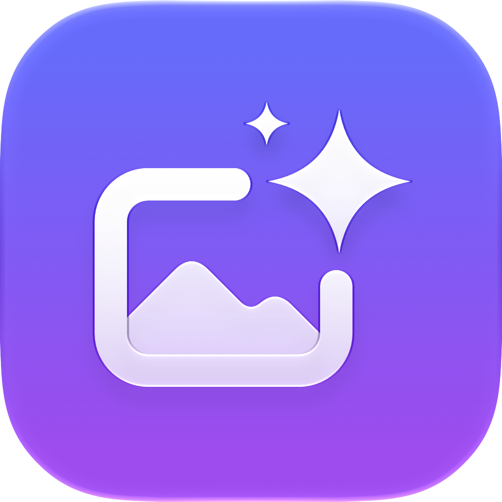
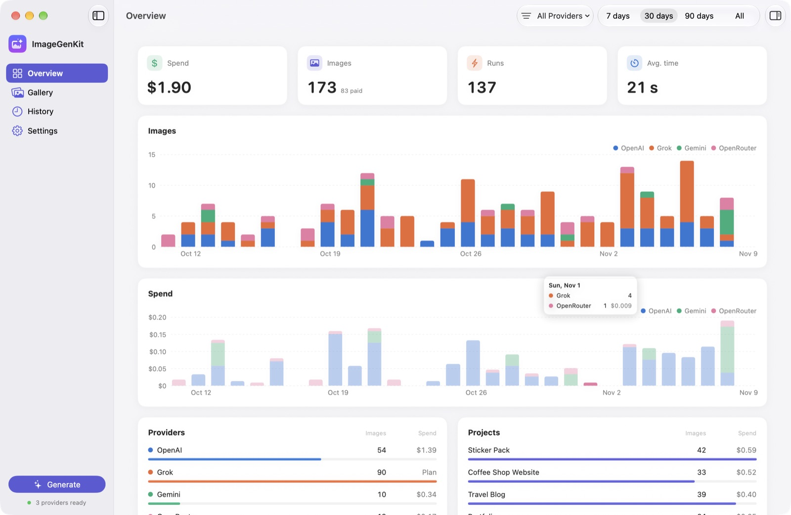
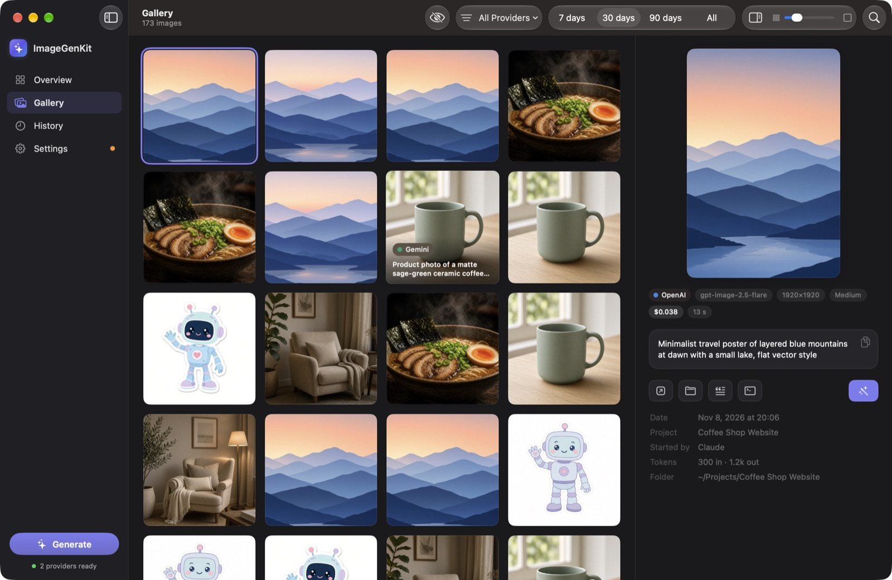
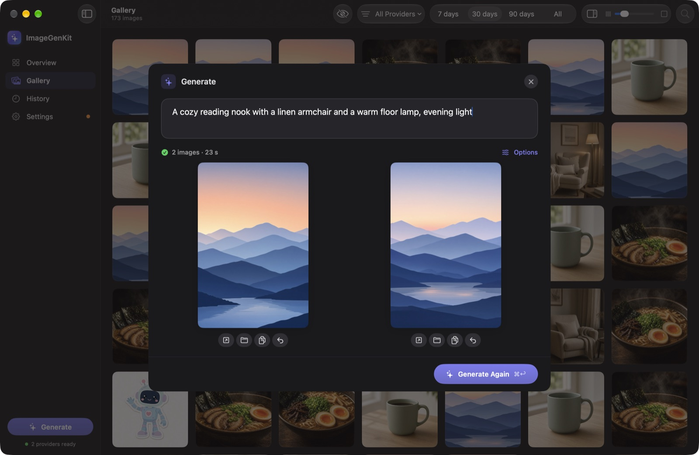
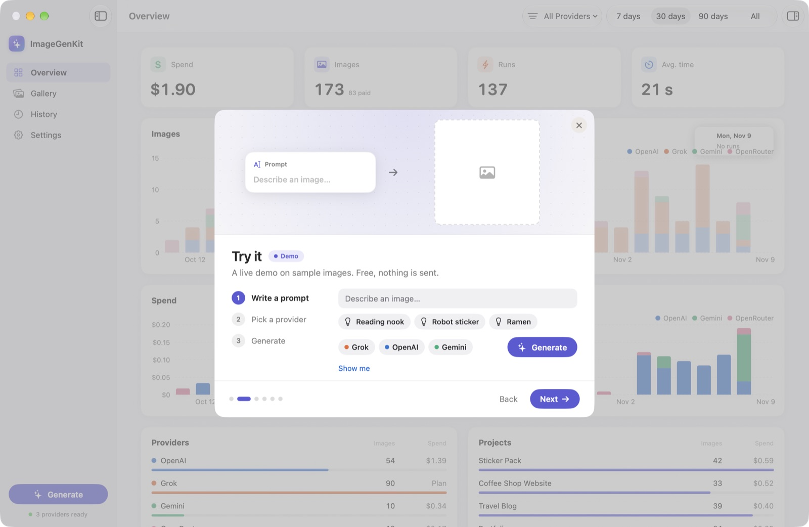
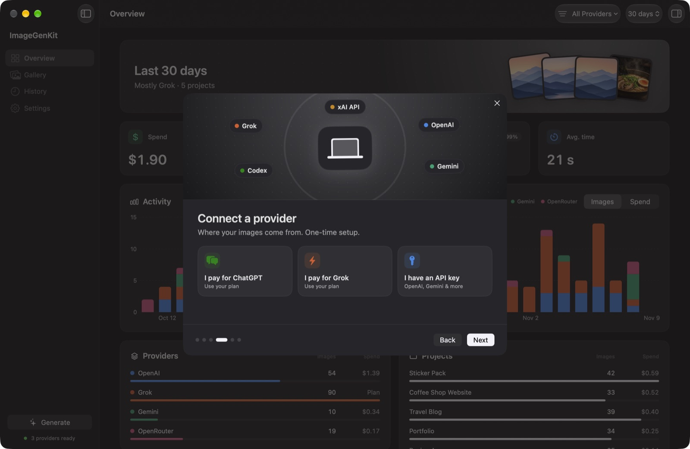
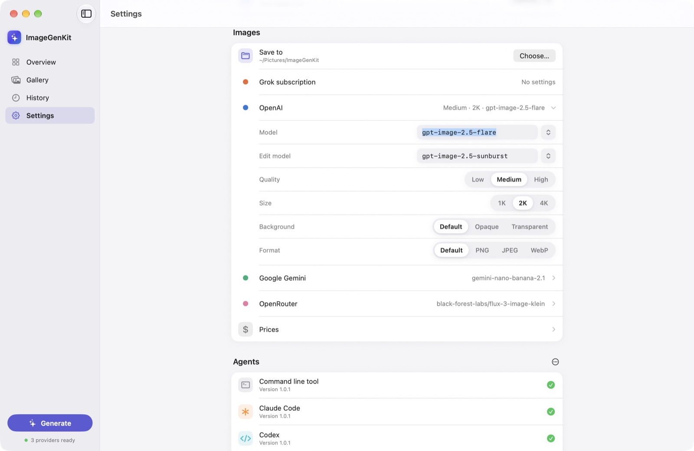
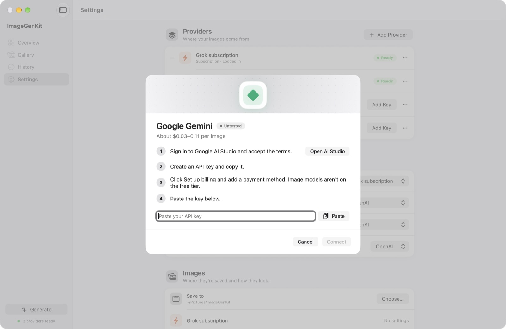

<p align="center">
  
</p>

<h1 align="center">ImageGenKit</h1>

<p align="center">
  AI images on your Mac with the accounts you already have: ChatGPT, Grok, OpenAI, Gemini and more.<br>
  Make images by hand, see everything you made and what it cost, and let Claude Code or Codex make images for you.
</p>

<p align="center">
  <a href="https://github.com/strics-at/imagegenkit/releases/latest"><b>Download for Mac</b></a> ·
  <a href="#install-with-your-ai-agent">Install with your AI agent</a> ·
  <a href="#command-line">Command line</a>
</p>



## What it does

- **Easy setup.** A short welcome tour finds what's already on your Mac (Grok or Codex logged in, saved API keys, Claude Code, Codex) and connects it in one click. If nothing is there, it asks simple questions ("I pay for ChatGPT", "I pay for Grok", "I have an API key") and walks you through the rest.
- **Use your subscriptions.** Make images with your ChatGPT plan (through Codex) or your Grok plan (through Grok Build), with no API key and no per-image bill.
- **Or bring an API key.** OpenAI, Google Gemini, xAI, OpenRouter, Recraft, Together AI, fal.ai, or any OpenAI-compatible API, each with a step-by-step guide to get a key. Keys stay in your macOS Keychain.
- **Generate by hand.** Write a prompt, add reference images, pick a provider, and set only the options that provider supports.
- **Gallery and history.** Everything you or your agents made, with prompts, sizes, costs and files. Use any image as a reference for the next one.
- **Usage and costs** per day, month, provider and project, plus a **menu bar** item with this month's spend, per-provider bars and recent images.
- **Monthly limits.** Set a spend or image limit. You get a notice at 80 % and 100 %, and if you choose "Stop paid images", paid providers pause until next month while your subscriptions keep working, for you and for your agents.
- **Settings per provider.** Model, quality, size, background and format for each provider, plus "Use for": which provider makes drafts, finals, edits and transparent PNGs. If one isn't set up, the next one in your list is used.
- **For AI agents.** Installs the `imagegenkit` command and a skill for Claude Code and Codex, so your agent makes images that follow your settings.
- **Stays up to date.** The app updates itself from GitHub, and the provider list updates without a new app version.

| Gallery | Generate |
|---|---|
|  |  |

| Welcome tour | Connect a provider |
|---|---|
|  |  |

| Settings | Key guide |
|---|---|
|  |  |

## Install

### Download

1. Download **ImageGenKit-x.y.z.zip** from the [latest release](https://github.com/strics-at/imagegenkit/releases/latest) and move **ImageGenKit** to Applications.
2. Open it. The welcome tour sets up a provider and your AI agents.

> If macOS says it can't check the app, open **System Settings › Privacy & Security** and click **Open Anyway**.

### Install with your AI agent

Paste this into Claude Code, Codex or another coding agent:

```text
Install ImageGenKit for me by following https://github.com/strics-at/imagegenkit/blob/main/docs/INSTALL-AGENT.md
```

### Command line only

```bash
curl -fsSL https://raw.githubusercontent.com/strics-at/imagegenkit/main/install.sh | bash
imagegenkit set-key openai     # or log in to a subscription: grok login / codex login
```

Requires macOS and Python 3.9+ (`xcode-select --install` provides it).

## Command line

```bash
imagegenkit draft "a cozy reading nook, warm light" -o nook.jpg   # quick, cheap
imagegenkit final "product photo of a red mug on marble" -o mug.png --aspect 4:5
imagegenkit edit "same mug on a wooden table" -i mug.png -o mug-wood.png
imagegenkit transparent "flat sticker of a smiling sun" -o sun.png
imagegenkit codex "..."                        # one provider directly (openai, grok, codex, gemini, ...)
imagegenkit providers                          # what's set up, order, task routing
imagegenkit check                              # live check of keys and logins
imagegenkit usage                              # this month's spend, images and limits
imagegenkit config set provider_defaults.openai.quality high
```

Saved paths go to stdout. Every run is logged to `~/.config/imagegenkit/log.jsonl`, which the app reads.

## Providers

| Provider | Sign in with | Status |
|---|---|---|
| OpenAI (GPT Image) | API key | Tested |
| Grok subscription | grok.com login via [Grok Build](https://x.ai/cli) | Tested |
| Codex subscription | ChatGPT plan login via the Codex CLI | Untested |
| xAI API | API key | Untested |
| Google Gemini (Nano Banana) | API key | Untested |
| OpenRouter | API key | Untested |
| Recraft | API key | Untested |
| Together AI | API key | Untested |
| fal.ai | API key | Untested |
| Any OpenAI-compatible API | API key | Custom |

"Untested" means we haven't made real images with it yet. The provider list lives in [`catalog/providers.json`](catalog/providers.json). Pull requests that add, fix or test providers are welcome.

## Privacy

Everything stays on your Mac. API keys are stored in the macOS Keychain and are only sent to the provider you choose. The app talks to GitHub only to check for updates and to refresh the provider list.

## Build from source

```bash
brew install xcodegen
xcodegen generate
open ImageGenKit.xcodeproj
```

macOS 26+, Xcode 26+. The CLI (`cli/imagegenkit.py`) is plain Python with no dependencies.

## License

[MIT](LICENSE) © 2026 STRICS IT GmbH
